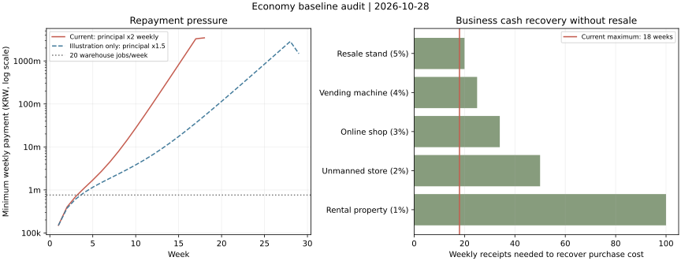

# 경제 밸런스 1차 점검

2026-10-28. 게임 흐름을 더 깊게 만들기 전, 현재 수치와 성장 경로를 측정한 기준선이다. **이번 작업은 분석과 조정 제안이며 게임 수치는 변경하지 않았다.**

## 핵심 결과

1. 현재 원금 상환 목표는 매주 2배다. 정상 정산을 이어가면 잔여 원금 상한 때문에 늦어도 18주 안에 원금이 끝난다. 18주 생존을 보장한다는 뜻은 아니다.
2. 가장 빠른 사업도 투자금 회수에 20번의 주간 수입이 필요하다. 사업 재판매가 없는 현재 구조에서는 정상 신규 게임의 클리어 목표에 대해 현금 보관보다 불리하다.
3. 자동 전략의 성과는 크게 갈린다. 병렬 판매 58/100 클리어, 보수적 순차 판매 41/100, 같은 보수적 전략에 소액 사업을 추가하면 30/100이었다. 아르바이트만 하면 6주차에 부족하고 즉시 판매만 사용하는 단순 정책은 100회 모두 미납 종료했다.
4. 일반 시장은 게시가를 기준으로 기본 가치를 환산하는 공통 구조다. 시장이 커져도 대부분 같은 판단을 반복하는 현상은 다음 단계인 물품별 거래 성격 설계에서 다룰 근거가 있다.

## 검증 범위와 재현

- 실제 엔진 기준 커밋: `63856b24f95ff59a515d00a9d1234b748f4aa353`. 실행 코드는 `scripts/audit-economy.mjs`, 실행 명령은 `npm run audit:economy`다. 기본 100개 시드(1–100) × 5개 전략 = **500회**. 전략 사이에는 같은 시드를 사용한다.
- 신규 50만원/원금 100억원, 주당 20행동, 100원 반올림, 현행 시장/태그/특별 매물/흥정/감정/수리/이자/원금 규칙을 그대로 실행했다. 저장소나 플레이어 저장을 바꾸지 않는다.
- 매입 전 정책은 게시 가격·표시 태그·화면에 보이는 흥정/경매 상태만 사용한다. 실제 가치와 상태는 구매 후 감정한 물품에만 사용한다. 구매자 숨은 지불 한도는 읽지 않는다.
- 감정 후 수리비가 현재 시장 가치의 20%(최소 비교 기준 1,000원) 이하이고 지불 가능하면 수리를 시도한다. 이 단순 정책은 비싼 고장품 수리 기회를 놓칠 수 있다. 가치 확인·수리는 행동 0회, 금전 비용을 실제로 차감한다.
- 시장 모집단 분석은 별도 500개 시드 × 시장별 8개 = 시장별 4,000개, 총 24,000개 매물이다. 이 부분의 숨은 가치는 분포 분석에만 사용하며 봇의 매입 판단에 넘기지 않는다.
- **실제 이용자 클리어율이나 최적 전략의 한계를 뜻하지 않는다.** 무료 수집 전용·태그별 정교한 선별·최적 재고 청산·모든 수리 전략을 탐색하지 않았다. 특히 전략 간 차이는 투자 비율·병렬 처리·판매 네고가 함께 달라 개별 효과를 분리한 실험이 아니다.
- 전체 3,864개 주간 현금 흐름에서 `시작 현금 + 수입 − 비용 − 납부 = 종료 현금`을 확인했다. 전체 실현 거래 17,158건. 명령 오류/6,000회 루프 상한 도달 시 분석은 실패하도록 했다.
- 원자료: `work/economy-audit-results/summary.json`, `runs.json`, `weeks.csv`, `trades.csv`. 출력 위치/시드 수는 `AUDIT_OUTPUT`, `AUDIT_SEEDS`로 지정한다. 소스와 결과 요약은 이 문서 옆 [BASELINE_SUMMARY.json](BASELINE_SUMMARY.json)에 보관한다. 큰 원자료는 분석용 work 디렉터리에 보관한다.
- 백분위는 정렬 후 `floor((n−1)×p)` 값이다. 종료 주차는 클리어와 미납을 구분해 아래에 표시한다.

## 현재 주간 상환 곡선

자발적 선상환 없이 의무 원금만 납부하는 계산이다. 해당 주 의무 원금을 뺀 잔여 원금으로 이자를 계산한다.

| 주차 |       의무 원금 |        이자 |            합계 |
| ---- | --------------: | ----------: | --------------: |
| 1주  |        50,000원 |   100,000원 |       150,000원 |
| 2주  |       100,000원 |   300,000원 |       400,000원 |
| 3주  |       200,000원 |   500,000원 |       700,000원 |
| 4주  |       400,000원 |   699,900원 |     1,099,900원 |
| 5주  |       800,000원 |   899,900원 |     1,699,900원 |
| 6주  |     1,600,000원 | 1,099,700원 |     2,699,700원 |
| 8주  |     6,400,000원 | 1,498,100원 |     7,898,100원 |
| 10주 |    25,600,000원 | 1,890,300원 |    27,490,300원 |
| 15주 |   819,200,000원 | 2,424,900원 |   821,624,900원 |
| 18주 | 3,446,450,000원 |         0원 | 3,446,450,000원 |

초반 1–3주는 이자 부담의 비중이 높고, 중후반은 지수 증가하는 원금 목표가 지배한다. 17주까지 의무 원금 누적은 6,553,550,000원이고 18주에는 남은 3,446,450,000원만 청구하므로 원금을 초과 청구하지 않는다. 시작금 500,000원을 포함해 창고 분류 20회/주(760,000원)를 모두 수행해도 6주차 정산에서 현금이 부족하다.

그림의 1.5배 선은 산술 비교안이며 게임에 적용하거나 전체 거래 봇으로 다시 검증한 결과가 아니다. 아르바이트 가로선도 주간 수입 비교선이며 파산 시점을 직접 뜻하지 않는다.

## 사업의 구조적 충돌

| 사업           |        투자금 | 주간 수익률 |   주간 수입 | 투자금 회수 | 가장 유리한 18회 수입 |
| -------------- | ------------: | ----------: | ----------: | ----------: | --------------------: |
| 중고 판매대    |     100,000원 |          5% |     5,000원 |        20회 |              90,000원 |
| 자동판매기     |     500,000원 |          4% |    20,000원 |        25회 |             360,000원 |
| 온라인 판매점  |   3,000,000원 |          3% |    90,000원 |        34회 |           1,620,000원 |
| 무인 매장      |  30,000,000원 |          2% |   600,000원 |        50회 |          10,800,000원 |
| 소형 임대 점포 | 300,000,000원 |          1% | 3,000,000원 |       100회 |          54,000,000원 |

실제로는 고가 사업을 1주차에 살 수 없으므로 위 18회 수입은 유리하게 잡은 상한이다. 사업을 사는 순간 현금이 줄고 재판매·담보 기능은 없다. 어떤 주차에 사더라도 남은 정상 진행 정산 횟수 안에 원금을 회수하지 못한다. 단순히 사업 구매를 일찍/늦게 하는 방식으로 해결되지 않는다.

모든 종류를 5개씩 보유하려면 1,668,000,000원이 필요하고 주간 수입은 18,575,000원이다. 10주차 의무 납부액 27,490,300원보다 작다. 이 비교는 사업만으로 모든 채무를 해결해야 한다는 설계 요구가 아니라 수입 규모의 기준이다.

## 전략별 실제 진행

| 자동 전략               | 클리어 | 미납 종료 | 미납 회차의 중앙 종료 주차 | 클리어 회차의 중앙 주차 |
| ----------------------- | -----: | --------: | -------------------------: | ----------------------: |
| 창고 분류만             |  0/100 |   100/100 |                        6주 |                     —주 |
| 보수적 순차 판매        | 41/100 |    59/100 |                        5주 |                    14주 |
| 성장형 병렬 판매        | 58/100 |    42/100 |                        5주 |                    12주 |
| 흥정 후 즉시 판매       |  0/100 |   100/100 |                        2주 |                     —주 |
| 보수적 판매 + 소액 사업 | 30/100 |    70/100 |                        5주 |                    14주 |

- 창고 분류만: 가장 높은 고정 임금만 반복. 거래/사업 없음.
- 보수적 순차 판매: 현금 60% 이내 게시가의 매물 중 비싼 것을 우선, 레플리카 태그 제외. 무료 매물이 남으면 수령 가능. 판매 1건을 끝낸 뒤 다음 거래로 이동. 감정 후 현재 시장 가치에 등록하고 최고 문의를 수락한다.
- 성장형 병렬 판매: 현금 90%까지 사용하고 판매 등록 한도까지 병렬 거래. 구매자의 첫 제안에는 현재 제안과 등록가 중간 금액으로 한 번 역제안한다. 이후 최고 제안을 수락한다.
- 즉시 판매: 현금 80%까지 사용하고 감정/선별적 수리 후 실제 가치 60%로 바로 매각한다. 게시판 판매를 하지 않는다.
- 소액 사업 병행: 보수적 순차 판매와 같되 정산액 3배+사업값을 넘는 현금이 있으면 중고 판매대를 최대 5개 구매한다.
- 판매 전략은 마지막 행동이 부족하면 신규 매입을 멈추고 일하거나, 아직 등록하지 않은 물품을 즉시 판매한다. 등록된 매물을 적극적으로 취소·청산하는 최적 정책은 구현하지 않았다.

사업 병행의 클리어 수가 낮아진 사실과 위 현금 회수 계산은 사업 구조를 손볼 근거다. 단순 봇 결과만으로 개별 이용자의 실패를 예측하거나 이 수치를 목표 클리어율로 확정하지 않는다.

미납 때 현금+보유품 60% 평가액은 청구액을 충족하지만 실제 현금이 부족했던 회차: serial: 8/59, parallel: 5/42, business: 2/70. 이는 원자료의 사후 진단이며 해당 물품을 남은 행동으로 실제로 모두 팔 수 있었다는 뜻은 아니다. 현금과 보유 가치를 구분하는 플레이 압박이 존재한다.

## 시장 진입 속도와 거래 규모

진입은 화면 방문이 아니라 실제 첫 구매다. 중앙 주차는 **그 시장까지 진입한 회차만** 계산했으며 괄호는 전체 100회 중 진입 수다.

| 시장          | 보수적 순차 판매 | 성장형 병렬 판매 |
| ------------- | ---------------: | ---------------: |
| 중고 장터     |    1주 (100/100) |    1주 (100/100) |
| 컴퓨터시장    |     2주 (83/100) |     1주 (88/100) |
| 악기시장      |     2주 (71/100) |     2주 (82/100) |
| 중고차시장    |     5주 (63/100) |     4주 (78/100) |
| 부동산 시장   |     7주 (60/100) |     6주 (77/100) |
| 고가 경매시장 |    11주 (50/100) |     8주 (76/100) |

| 시장          |                   게시 가격 범위 | 실제 시장 가치/게시가 중앙값 | 흥정·수리 전 즉시 판매 흑자 비율 |
| ------------- | -------------------------------: | ---------------------------: | -------------------------------: |
| 중고 장터     |               10,000원–500,000원 |                       1.57배 |                            44.0% |
| 컴퓨터시장    |            800,000원–1,200,000원 |                       1.57배 |                            45.6% |
| 악기시장      |         1,500,000원–10,000,000원 |                       1.57배 |                            45.1% |
| 중고차시장    |        10,000,000원–80,000,000원 |                       1.52배 |                            43.5% |
| 부동산 시장   |    100,000,000원–1,000,000,000원 |                       1.36배 |                            43.4% |
| 고가 경매시장 | 1,000,000,000원–10,000,000,000원 |                       1.36배 |                            43.0% |

마지막 비율은 모집단에서 `실제 가치×60% − 게시가 − 초보 감정비 > 0`인 비율이다. 가치/상태를 미리 알고 살 수 있다는 뜻도 아니고, 실제 플레이의 거래 성공 확률도 아니다. 시장 상황은 초기 상태 기준이다. 실현 거래의 시장별 매입가·이익·손실 비중은 요약 JSON의 realizedTradesByMarket에 보관한다. 이익은 매각액−매입가−감정비−수리비이며 주간 채무 납부와 미매각 재고는 별도다.

일반 매물은 시장 게시가를 55% 기준으로 환산한 기본 가치에 상태/태그/희귀도 보정을 적용한다. 카테고리별 `CATEGORY_PRICING`은 일반 시장의 marketItem 경로에서는 직접 적용되지 않는다. 대부분 시장이 유사한 수익 구조라 숫자 규모만 바뀌는 반복감이 생길 근거가 있다. 이번 단계에서 물품 규칙을 추가하지 않고 다음 설계의 기준으로 기록한다.

## 조정 후보 — 확정/적용 아님

### 1. 의무 원금 증가 속도 비교

시작금 50만원·주당 20행동·현재 이율을 유지하고 원금 목표의 증가 배수만 바꾼 산술 비교다. 목표는 100원 반올림하고 남은 원금을 초과하지 않는다.

| 주간 원금 증가 | 정상 의무 납부 시 원금 종료 | 6주차 총 납부 | 10주차 총 납부 |
| -------------- | --------------------------: | ------------: | -------------: |
| 2배            |                        18주 |   2,699,700원 |   27,490,300원 |
| 1.6배          |                        25주 |   1,624,200원 |    5,334,300원 |
| 1.5배          |                        29주 |   1,479,600원 |    3,821,100원 |
| 1.4배          |                        34주 |   1,368,800원 |    2,932,400원 |

**첫 비교 적용 후보는 1.5배**다. 현재 2배의 중후반 급증을 완화하면서 같은 정산 구조를 유지할 수 있다. 다만 초반 이자 부담은 그대로이고 현재 사업 중 고가 사업의 회수 문제를 이 변경 하나로 해결할 수는 없다. 의무 납부만 할 때 총 이자도 현재 24,837,000원에서 1.5배 안의 65,361,500원으로 늘어난다. 기간이 길어져 반복감이 커질 가능성도 사람 플레이로 확인해야 한다. 위 산술만으로 클리어율 개선을 단정하지 않는다.

### 2. 사업 원금을 회수 가능한 자산으로 만들기

사용자가 정한 주간 최대 5%·고가일수록 낮은 수익률·구매 행동 0회·종류별 5개를 보존하려면 투자금을 영구 소모시키는 현재 구조의 재검토가 필요하다. 단순 후보는 **구매가의 90%에 사업 매각**이다. 추가 운영 화면/직원/유지비 없이 자금을 회수하는 선택만 제공한다.

이 후보에서는 매각 손실 10%를 주간 수입으로 메우는 데 5/4/3/2/1% 사업별 2/3/4/5/10번의 수령이 필요하다. 같은 주에 사고 수입 1회를 받은 뒤 즉시 되팔아도 최대 수입 5%보다 손실 10%가 커 단순 즉시 차익이 나지 않는다. 실제 적용 시에는 정산 중 거래 제한·같은 주 중복 수입 차단·매각 시점·행동 비용을 검증/확정해야 한다. 매각 기능은 아직 구현하지 않았다.

### 3. 적용 후 비교 기준

- 현재 100개 시드를 동일 정책으로 재실행하고 미납/클리어 주차, 각 시장 진입 수, 거래 이익/손실, 사업 순수입을 비교한다.
- 사람 플레이에서는 1–3주 손실을 회복할 여유, 중간 시장 진입 체감, 사업에 묶인 현금, 반복감과 실제 플레이 시간을 확인한다. 목표 플레이 시간/클리어율/권장 시장 진입 주차는 아직 확정하지 않는다.
- 한 번에 변경한 항목의 효과를 구분한다. 원금 증가율만 / 사업 회수만 / 두 항목 함께를 따로 비교한 뒤 수치를 정한다.
- 매물별 거래 성격과 특별 매물 심화는 이 기준선 이후 다음 단계에서 진행한다.
